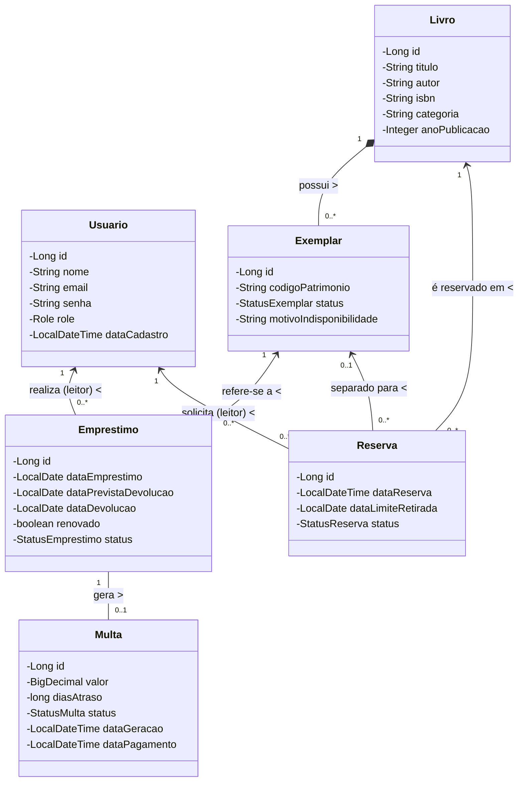

# 📚 API da Biblioteca do Campus (GRUAPIM — Tema 01)

API RESTful desenvolvida em **Java 17** e **Spring Boot 4** para o gerenciamento completo do acervo, exemplares físicos, empréstimos, devoluções, renovações, multas por atraso e fila de reservas da Biblioteca Universitária do Campus.

---

## 🛠️ Tecnologias Utilizadas

- **Linguagem:** Java 17
- **Framework:** Spring Boot 4.1.1 (`spring-boot-starter-webmvc`, `spring-boot-starter-data-jpa`, `spring-boot-starter-validation`)
- **Segurança:** Spring Security + OAuth2 Resource Server com **JWT Assimetricamente Assinado (RSA-2048)** e criptografia de senhas **BCrypt**
- **Banco de Dados:** PostgreSQL 16 (Produção/Docker) e H2 Database em memória (Testes Funcionais)
- **Documentação Interativa:** SpringDoc OpenAPI 3 / Swagger UI (`3.0.2`)
- **Testes e Qualidade:** JUnit 5, Mockito, Spring MockMvc e **JaCoCo** (`0.8.12`)
- **Containerização:** Docker (Multi-stage build) e Docker Compose

---

## 🏛️ Arquitetura do Projeto

O projeto segue a arquitetura em camadas no pacote base `com.apim.apibiblioteca`:

```text
apibiblioteca/
├── docs/
│   ├── diagrama-casos-de-uso.md     # Diagrama de Casos de Uso UML e Matriz RF01–RF17
│   └── diagrama-classes.md          # Diagrama de Classes de Domínio UML
├── src/main/java/com/apim/apibiblioteca/
│   ├── config/                      # SecurityConfig, JwtConfig, OpenApiConfig, DataInitializer
│   ├── controller/                  # Endpoints REST (Auth, Usuario, Livro, Exemplar, Emprestimo, Multa, Reserva)
│   ├── dto/                         # Records de Request/Response com Bean Validation
│   ├── enums/                       # Role, StatusExemplar, StatusEmprestimo, StatusMulta, StatusReserva
│   ├── exception/                   # Exceções de domínio e GlobalExceptionHandler (HTTP 400, 401, 403, 404, 422)
│   ├── model/                       # Entidades JPA (Usuario, Livro, Exemplar, Emprestimo, Multa, Reserva)
│   ├── repository/                  # Interfaces Spring Data JPA
│   ├── security/                    # UserDetailsImpl e UserDetailsServiceImpl
│   └── service/                     # Regras de negócio e controle transacional
├── src/test/java/com/apim/apibiblioteca/
│   ├── service/                     # 40 Testes Unitários (JUnit 5 + Mockito)
│   └── controller/                  # 52 Testes Funcionais de Integração (MockMvc + H2)
├── Dockerfile                       # Multi-stage build (Maven + JRE 17 Alpine)
└── compose.yaml                     # Orquestração PostgreSQL 16 + API
```

---

## 🚀 Como Executar o Projeto

### Pré-requisitos
- **Docker** e **Docker Compose** instalados (para execução containerizada ou apenas do banco de dados)
- **JDK 17+** (opcional, caso deseje rodar fora do container via Maven Wrapper)

---

### Opção 1: Execução Completa via Docker Compose (Recomendado)

Sobe automaticamente o banco **PostgreSQL 16** (com *healthcheck*) e compila/executa o container da **API Spring Boot**:

```bash
cd apibiblioteca
docker compose up --build
```

Para rodar em segundo plano (*detached mode*):
```bash
docker compose up -d --build
```

A API estará disponível em: **`http://localhost:8080`**

---

### Opção 2: Execução Local via Maven Wrapper

1. Suba apenas o container do banco de dados PostgreSQL na porta `5432`:
   ```bash
   cd apibiblioteca
   docker compose up -d postgres
   ```

2. Execute a aplicação localmente utilizando o Maven Wrapper:
   - **Windows (PowerShell / CMD):**
     ```powershell
     .\mvnw.cmd spring-boot:run
     ```
   - **Linux / macOS:**
     ```bash
     ./mvnw spring-boot:run
     ```

---

## 🔑 Credenciais Pré-Cadastradas (`DataInitializer`)

Ao iniciar a aplicação com o banco vazio, o componente `DataInitializer` popula automaticamente **3 usuários** iniciais:

| ID | Perfil (`Role`) | E-mail | Senha | Permissões Principais |
| :---: | :--- | :--- | :--- | :--- |
| `1` | **`BIBLIOTECARIO`** | `bibliotecario@biblioteca.edu.br` | `senha1234` | Gestão completa do acervo, exemplares, registro de empréstimos/devoluções, baixa de multas, fila de reservas e relatórios gerenciais. |
| `2` | **`LEITOR`** | `leitor@biblioteca.edu.br` | `senha1234` | Consulta ao acervo, renovação dos próprios empréstimos, solicitação/cancelamento de reservas e consulta às próprias multas. |
| `3` | **`LEITOR`** | `maria@biblioteca.edu.br` | `senha1234` | Segunda conta de leitor para testar cenários de disputa de exemplares e fila FIFO de reservas. |

---

## 📖 Documentação Interativa (Swagger UI)

Com a aplicação em execução, acesse a interface do **Swagger UI**:

👉 **[http://localhost:8080/swagger-ui/index.html](http://localhost:8080/swagger-ui/index.html)**  
*(Especificação JSON OpenAPI disponível em: `http://localhost:8080/v3/api-docs`)*

### Como se autenticar no Swagger UI:
1. Expanda o endpoint **`POST /api/auth/login`** na seção **1. Autenticação**.
2. Envie o JSON com uma das credenciais acima, por exemplo:
   ```json
   {
     "email": "bibliotecario@biblioteca.edu.br",
     "senha": "senha1234"
   }
   ```
3. Copie o valor do campo `"token"` retornado na resposta `200 OK`.
4. Clique no botão **`Authorize`** (cadeado no topo direito da página), cole o token JWT no campo **Value** e confirme em **Authorize**.
5. Todas as requisições subsequentes feitas pelo Swagger enviarão automaticamente o cabeçalho `Authorization: Bearer <token>`.

---

## 🛣️ Referência de Endpoints e Requisitos Funcionais (RF01 a RF17)

| RF | Método | Endpoint | Descrição | Acesso / Role |
| :---: | :---: | :--- | :--- | :---: |
| **RF01** | `POST` | `/api/auth/register` | Cadastra um novo usuário com perfil `LEITOR` | Público |
| **RF02** | `POST` | `/api/auth/login` | Autentica usuário (`LEITOR` ou `BIBLIOTECARIO`) e retorna o token JWT | Público |
| **RF03** | `POST` | `/api/livros` | Cadastra um novo livro no acervo (ISBN único) | `BIBLIOTECARIO` |
| **RF03** | `PUT` | `/api/livros/{id}` | Atualiza dados catalográficos de um livro existente | `BIBLIOTECARIO` |
| **RF03** | `DELETE` | `/api/livros/{id}` | Remove livro do acervo (se não houver exemplares emprestados/reservas) | `BIBLIOTECARIO` |
| **RF04** | `POST` | `/api/livros/{livroId}/exemplares` | Adiciona um novo exemplar físico ao livro (`codigoPatrimonio` único) | `BIBLIOTECARIO` |
| **RF04** | `GET` | `/api/livros/{livroId}/exemplares` | Lista todos os exemplares físicos de um livro | `BIBLIOTECARIO` |
| **RF04** | `GET` | `/api/exemplares/{id}` | Busca detalhes e status de um exemplar pelo ID | `BIBLIOTECARIO` |
| **RF04** | `PATCH` | `/api/exemplares/{id}/indisponibilizar` | Marca exemplar como `INDISPONIVEL` informando o motivo | `BIBLIOTECARIO` |
| **RF04** | `PATCH` | `/api/exemplares/{id}/disponibilizar` | Reativa exemplar `INDISPONIVEL` de volta para `DISPONIVEL` | `BIBLIOTECARIO` |
| **RF05** | `GET` | `/api/livros` | Busca paginada de livros com filtros (`titulo`, `autor`, `categoria`) e disponibilidade | Público |
| **RF05** | `GET` | `/api/livros/{id}` | Busca detalhes de um livro por ID e sua quantidade disponível | Público |
| **RF06** | `POST` | `/api/emprestimos` | Registra empréstimo de exemplar disponível para leitor (prazo de 14 dias) | `BIBLIOTECARIO` |
| **RF07** | `PATCH` | `/api/emprestimos/{id}/devolucao` | Registra devolução, calcula multa se houver atraso e separa para fila de reserva | `BIBLIOTECARIO` |
| **RF08** | `PATCH` | `/api/emprestimos/{id}/renovar` | Renova próprio empréstimo ativo por +7 dias (máximo 1 vez) | `LEITOR` |
| **RF09** | `PATCH` | `/api/multas/{id}/pagar` | Registra pagamento de multa pendente e desbloqueia o leitor | `BIBLIOTECARIO` |
| **RF10** | `GET` | `/api/emprestimos/meus` | Lista todos os empréstimos do próprio leitor autenticado | `LEITOR` |
| **RF10** | `GET` | `/api/emprestimos` | Lista empréstimos com filtros (`leitorId`, `status`, `atrasados`) | `BIBLIOTECARIO` |
| **RF10** | `GET` | `/api/multas/minhas` | Lista as multas do próprio leitor autenticado (filtro opcional `status`) | `LEITOR` |
| **RF10** | `GET` | `/api/multas` | Lista multas de qualquer leitor com filtros (`leitorId`, `status`) | `BIBLIOTECARIO` |
| **RF11** | `POST` | `/api/reservas` | Solicita reserva na fila FIFO quando o livro não possui exemplares disponíveis | `LEITOR` |
| **RF12** | `POST` | `/api/reservas/{id}/retirar` | Registra retirada de exemplar separado convertendo a reserva em empréstimo | `BIBLIOTECARIO` |
| **RF13** | `PATCH` | `/api/reservas/{id}/cancelar` | Cancela reserva ativa e repassa exemplar separado ao próximo da fila | `LEITOR` / `BIBLIOTECARIO` |
| **RF14** | `GET` | `/api/reservas/minhas` | Lista todas as reservas do próprio leitor autenticado | `LEITOR` |
| **RF14** | `GET` | `/api/reservas/livro/{livroId}/fila` | Consulta a fila ordenada (FIFO) de reservas ativas de um livro | `BIBLIOTECARIO` |
| **RF14** | `POST` | `/api/reservas/processar-expiradas` | Expira reservas não retiradas em 3 dias e realoca o exemplar | `BIBLIOTECARIO` |
| **RF15** | `GET` | `/api/relatorios/livros-mais-emprestados` | Relatório dos 10 livros mais emprestados no período (`inicio` a `fim`) | `BIBLIOTECARIO` |
| **RF16** | `GET` | `/api/relatorios/emprestimos-atrasados` | Relatório de empréstimos em atraso ordenados pelo maior atraso | `BIBLIOTECARIO` |
| **RF17** | `GET` | `/api/relatorios/multas-pendentes-por-leitor` | Relatório do total acumulado de multas pendentes agrupado por leitor | `BIBLIOTECARIO` |

---

## ⚖️ Resumo das Regras de Negócio

1. **Empréstimos (RF08):**
   - Prazo padrão de devolução de **14 dias corridos**.
   - Limite máximo de **3 empréstimos ativos simultâneos** por leitor.
   - Bloqueado caso o leitor possua qualquer **multa `PENDENTE`** ou **empréstimo em atraso**.
   - Caso o exemplar esteja `SEPARADO` para uma reserva `PRONTA_PARA_RETIRADA`, apenas o leitor titular daquela reserva pode retirá-lo (convertendo a reserva para `ATENDIDA`).
2. **Devolução e Multa Automática (RF09, RF12, RF13):**
   - Se devolvido após a `dataPrevistaDevolucao`, gera automaticamente uma `Multa` com status `PENDENTE` no valor de **R$ 1,00 por dia de atraso** (sem teto máximo).
   - Na devolução, se houver fila de reserva `AGUARDANDO` para o livro, o exemplar passa automaticamente para `SEPARADO` e a reserva mais antiga (FIFO) avança para `PRONTA_PARA_RETIRADA` com prazo de **3 dias** (`dataLimiteRetirada`). Caso contrário, o exemplar volta para `DISPONIVEL`.
3. **Renovação (RF10):**
   - Prorroga a data prevista de devolução em **+7 dias**.
   - Permitida **apenas 1 única vez** por empréstimo (`renovado = false`), desde que não esteja em atraso, o leitor não tenha multas pendentes e não existam reservas aguardando pelo livro.
4. **Fila de Reservas e Expiração (RF14–RF17):**
   - Só é permitido reservar um livro quando **nenhum exemplar está `DISPONIVEL`** no acervo.
   - Um leitor não pode reservar um livro que já esteja emprestado para ele ou para o qual já possua reserva ativa.
   - Se a reserva `PRONTA_PARA_RETIRADA` não for retirada até `dataLimiteRetirada`, ela muda para `EXPIRADA` e o exemplar separado é transferido ao próximo leitor da fila ou liberado como `DISPONIVEL`.

---

## 📐 Diagramas UML

Os diagramas completos  [`docs/`](./docs/):

- 📄 **[Diagrama de Casos de Uso (`docs/diagrama casos de uso.png`)](./docs/diagrama%20casos%20de%20uso.png)**
- 📄 **[Diagrama de Classes (`docs/diagrama de classes.png`)](./docs/diagrama%20de%20classes.png)**

### Visão Geral — Diagrama de Classes de Domínio



---

## 🧪 Testes Automatizados e Cobertura (JaCoCo)

O projeto conta com **93 testes automatizados** (divididos entre testes unitários de serviços com **JUnit 5 + Mockito** e testes funcionais ponta a ponta de controllers com **MockMvc + Spring Security + H2 Database**).

### Executar todos os testes e gerar o relatório do JaCoCo:

- **Windows:**
  ```powershell
  .\mvnw.cmd clean test jacoco:report
  ```
- **Linux / macOS:**
  ```bash
  ./mvnw clean test jacoco:report
  ```

### Visualizar o Relatório de Cobertura:
Após a execução do comando acima, abra o arquivo HTML gerado no navegador:
👉 **`apibiblioteca/target/site/jacoco/index.html`**

**Métricas atuais de cobertura:**
- **Total de Testes:** 93 testes passando (`0 falhas`, `0 erros`)
- **Cobertura de Controllers:** `100%`
- **Cobertura Geral de Linhas:** `> 91%`
