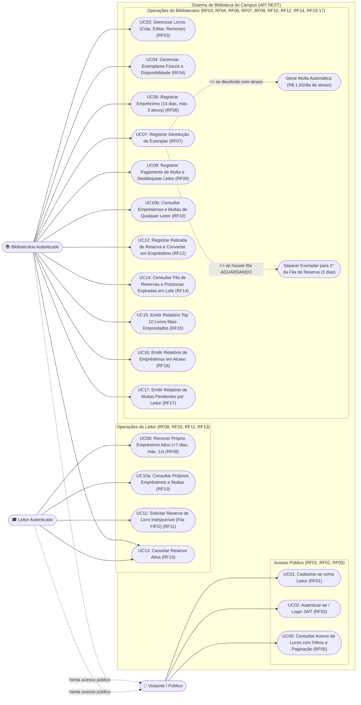
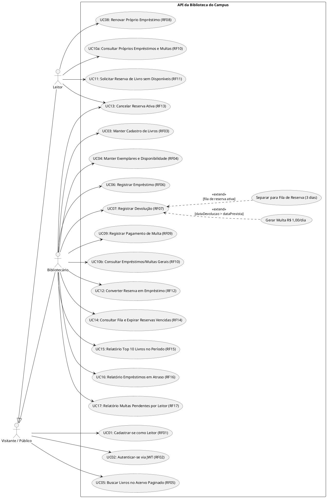

# Diagrama de Casos de Uso — API da Biblioteca do Campus

Este documento apresenta o **Diagrama de Casos de Uso UML** do sistema de gerenciamento da Biblioteca do Campus, contemplando todos os requisitos funcionais (**RF01 a RF17**) e os três perfis de interação (**Público / Visitante**, **Leitor** e **Bibliotecário**).

---

## 1. Visualização em Mermaid

---

## 2. Especificação em PlantUML

Caso deseje exportar o diagrama na notação clássica PlantUML:

---

## 3. Matriz de Rastreabilidade dos Casos de Uso (RF01 a RF17)

| Caso de Uso | Requisito | Ator(es) | Endpoint Principal | Resumo das Regras de Negócio |
| :--- | :--- | :--- | :--- | :--- |
| **UC01** | **RF01** | Público | `POST /api/auth/register` | Cadastra novo usuário com perfil `LEITOR`, e-mail único e senha BCrypt (mín. 8 caracteres). Nunca retorna a senha. |
| **UC02** | **RF02** | Público | `POST /api/auth/login` | Autentica por e-mail e senha e emite token JWT RSA. Retorna `401` genérico em falha sem revelar qual campo errou. |
| **UC03** | **RF03** | Bibliotecário | `POST/PUT/DELETE /api/livros` | CRUD de livros com ISBN único. Impede exclusão se houver exemplares emprestados/separados ou reservas ativas. |
| **UC04** | **RF04** | Bibliotecário | `POST /api/livros/{id}/exemplares` `PATCH /api/exemplares/{id}/*` | Cadastra cópias físicas (`codigoPatrimonio` único) e controla transição entre `DISPONIVEL` e `INDISPONIVEL`. |
| **UC05** | **RF05** | Público | `GET /api/livros` | Consulta paginada por título, autor ou categoria, calculando dinamicamente a `quantidadeDisponivel`. |
| **UC06** | **RF06** | Bibliotecário | `POST /api/emprestimos` | Empresta exemplar `DISPONIVEL` por 14 dias. Limite de 3 empréstimos ativos; bloqueia leitores com atraso ou multa pendente. |
| **UC07** | **RF07** | Bibliotecário | `PATCH /api/emprestimos/{id}/devolucao` | Finaliza empréstimo; gera multa de R$ 1,00/dia se atrasado; separa exemplar por 3 dias se houver fila de reserva. |
| **UC08** | **RF08** | Leitor | `PATCH /api/emprestimos/{id}/renovar` | Prorroga o próprio empréstimo em +7 dias (máx. 1 vez), desde que sem atraso, sem bloqueio e sem reserva ativa para o livro. |
| **UC09** | **RF09** | Bibliotecário | `PATCH /api/multas/{id}/pagar` | Quita multa pendente (`status = PAGA`) e libera o leitor caso não possua outras pendências. |
| **UC10** | **RF10** | Leitor / Bibliotecário | `GET /api/emprestimos/meus` `GET /api/emprestimos` | Leitor consulta apenas seus próprios empréstimos/multas; Bibliotecário consulta todos com filtros. |
| **UC11** | **RF11** | Leitor | `POST /api/reservas` | Entra na fila FIFO (`AGUARDANDO`) quando `quantidadeDisponivel == 0`, se não estiver bloqueado nem com o livro em mãos. |
| **UC12** | **RF12** | Bibliotecário | `POST /api/reservas/{id}/retirar` | Converte reserva `PRONTA_PARA_RETIRADA` em `Emprestimo` de 14 dias e marca reserva como `ATENDIDA`. |
| **UC13** | **RF13** | Leitor / Bibliotecário | `PATCH /api/reservas/{id}/cancelar` | Cancela reserva ativa; se tinha exemplar separado, repassa ao próximo da fila (+3 dias) ou devolve para `DISPONIVEL`. |
| **UC14** | **RF14** | Bibliotecário | `GET /api/reservas/livro/{id}/fila` `POST /api/reservas/processar-expiradas` | Lista fila ordenada do livro e expira em lote reservas cujo prazo de 3 dias venceu, repassando os exemplares. |
| **UC15** | **RF15** | Bibliotecário | `GET /api/relatorios/livros-mais-emprestados` | Lista os 10 livros mais emprestados em um intervalo de datas (`inicio` e `fim`). |
| **UC16** | **RF16** | Bibliotecário | `GET /api/relatorios/emprestimos-atrasados` | Lista todos os empréstimos vencidos e não devolvidos, ordenados do maior atraso para o menor. |
| **UC17** | **RF17** | Bibliotecário | `GET /api/relatorios/multas-pendentes-por-leitor` | Lista o montante total de multas `PENDENTE` acumulado por cada leitor. |
