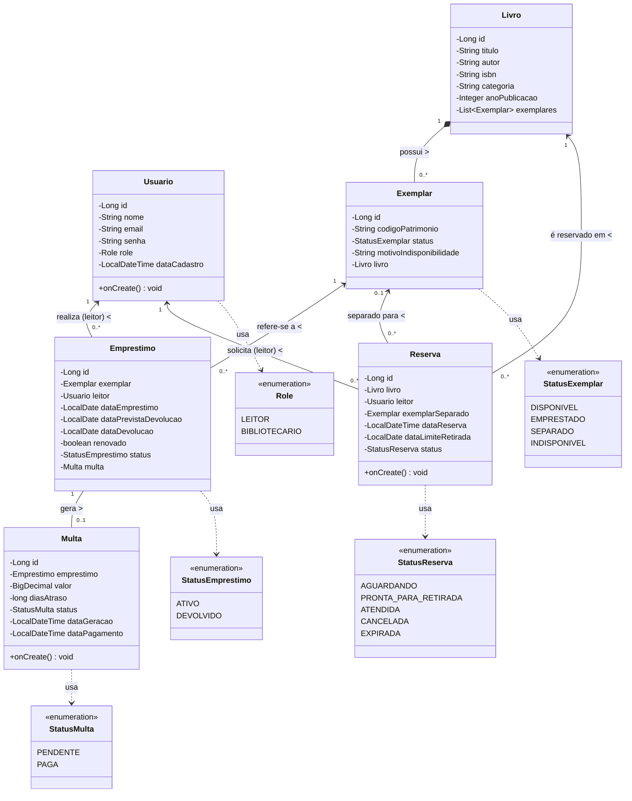
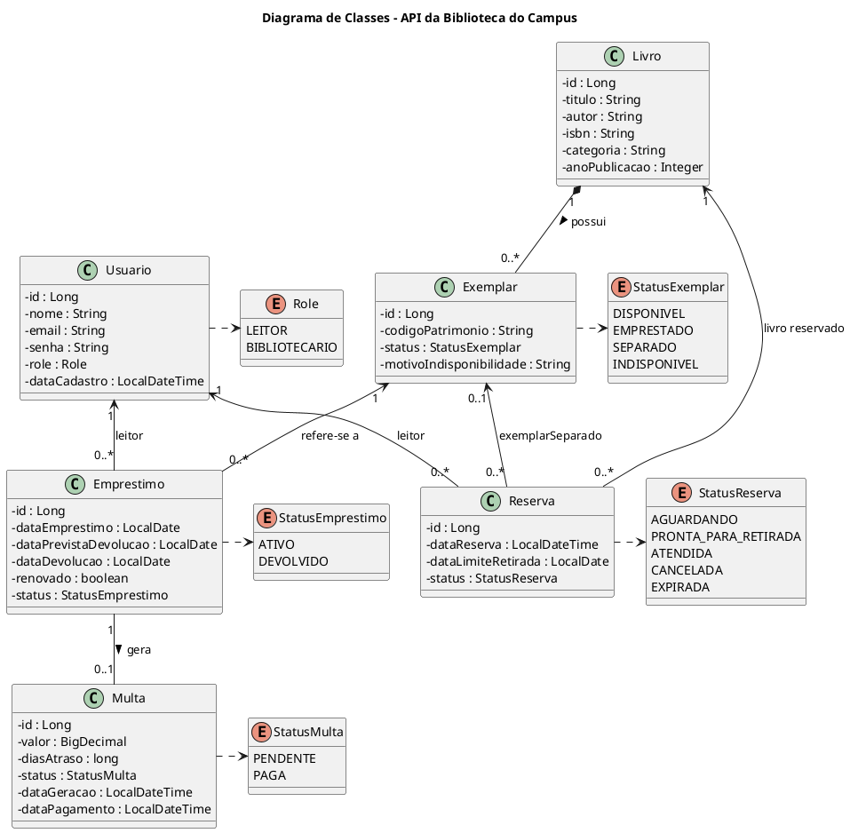

# Diagrama de Classes UML — API da Biblioteca do Campus

Este documento apresenta o **Diagrama de Classes de Domínio** da API da Biblioteca do Campus, detalhando as entidades JPA, suas propriedades, enumerações e cardinalidades de relacionamento.

---

## 1. Diagrama de Classes (Mermaid)

---

## 2. Código PlantUML Equivalente

Caso deseje exportar o diagrama utilizando o [PlantUML](https://www.planttext.com/):

---

## 3. Detalhamento das Entidades e Relacionamentos

| Entidade | Tabela no Banco | Relacionamentos Principais | Regras de Integridade e Domínio |
| :--- | :--- | :--- | :--- |
| **`Usuario`** | `usuarios` | `1:N` com `Emprestimo` e `Reserva` | `email` único; senha criptografada com BCrypt; perfil `LEITOR` ou `BIBLIOTECARIO`. |
| **`Livro`** | `livros` | `1:N` com `Exemplar` (`CascadeType.ALL`, `orphanRemoval = true`) | `isbn` único; representa a obra catalográfica e agrega seus exemplares físicos. |
| **`Exemplar`** | `exemplares` | `N:1` com `Livro` | `codigoPatrimonio` único; controla a máquina de estados física (`DISPONIVEL`, `EMPRESTADO`, `SEPARADO`, `INDISPONIVEL`). |
| **`Emprestimo`** | `emprestimos` | `N:1` com `Exemplar` e `Usuario`; `1:1` opcional com `Multa` | Prazo inicial de **14 dias**; permite no máximo **1 renovação** (+7 dias) se não houver atraso, multa pendente ou fila de reserva. |
| **`Multa`** | `multas` | `1:1` com `Emprestimo` (`unique = true`) | Gerada automaticamente na devolução com atraso: **R$ 1,00 por dia de atraso** (sem teto máximo). Bloqueia novos empréstimos, renovações e reservas até ser `PAGA`. |
| **`Reserva`** | `reservas` | `N:1` com `Livro`, `Usuario` e `Exemplar` (opcional) | Fila FIFO ordenada por `dataReserva ASC`. Quando um exemplar é devolvido, vincula o `exemplarSeparado`, muda para `PRONTA_PARA_RETIRADA` e define `dataLimiteRetirada` (+3 dias). |
